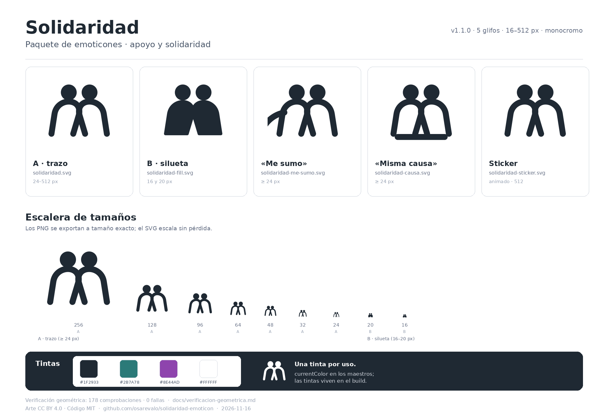
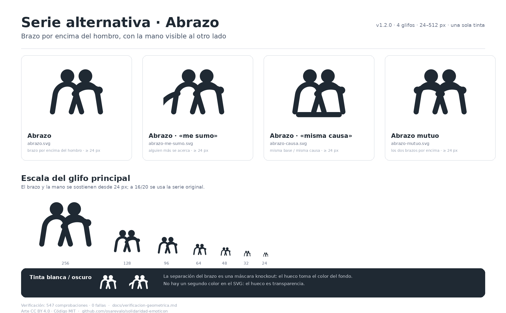

# Solidaridad — paquete de emoticones

Dos series de glifos monocromos que representan **apoyo y solidaridad**:
la original de cinco glifos («me solidarizo con vos», «me sumo», «misma causa»)
y la serie alternativa **«Abrazo»**, donde la figura izquierda pasa el brazo por
encima del hombro de la derecha. Diseñadas para leerse como *horizontalidad y
acompañamiento*, no como caridad desde arriba.

- **Canvas maestro:** 32 × 32 (`viewBox="0 0 32 32"`), trazo redondeado.
- **Concepto:** dos figuras idénticas que se inclinan hasta tocarse los hombros.
  **Los hombros se tocan; las cabezas no.**
- **Salidas:** SVG con `currentColor`, PNG de 16 a 512 px en cuatro tintas,
  sticker animado en WebP animado + GIF, y hoja de contactos.
- **Verificación:** 364 comprobaciones geométricas y de empaquetado, 0 fallas
  ([acta](docs/verificacion-geometrica.md)).
- **Licencias:** arte y documentación [CC BY 4.0](LICENSE-ARTWORK); código
  [MIT](LICENSE). Uso comercial permitido.

[Repositorio público](https://github.com/osarevalo/solidaridad-emoticon) · arte
[CC BY 4.0](LICENSE-ARTWORK) · código [MIT](LICENSE)





## Contenido

```
src/                       SVG maestros (5)
  solidaridad.svg            A · trazo (≥ 24 px)
  solidaridad-fill.svg       B · silueta (16 y 20 px)
  solidaridad-me-sumo.svg    «Me sumo» (≥ 24 px)
  solidaridad-causa.svg      «Misma causa» (≥ 24 px)
  solidaridad-sticker.svg    sticker animado (SMIL, 550 ms)
  abrazo.svg                 serie Abrazo · brazo por encima
  abrazo-me-sumo.svg         serie Abrazo · «me sumo»
  abrazo-causa.svg           serie Abrazo · «misma causa»
  abrazo-mutuo.svg           serie Abrazo · mutuo

dist/
  png/{ink,teal,violet,white}/   PNG a tamaño exacto, con alfa
  sticker/{tinta}/               sticker estático 128/256/512 (PNG + WebP)
  sticker/animado/               WebP animado 256/512 + GIF 512

preview/
  preview.html               vista previa autocontenida (abrir en navegador)
  contact-sheet.png          hoja de contactos de la serie original
  contact-sheet-abrazo.png   hoja de contactos de la serie Abrazo

docs/
  verificacion-geometrica.md acta generada por scripts/verify_geometry.py

scripts/                     build reproducible (Python + cairosvg)
  build_assets.py
  build_sticker.py
  verify_geometry.py
  make_preview.py
  requirements.txt

DOCUMENTO-MAESTRO.md         documento de diseño completo y autocontenido
CHANGELOG.md                 del borrador v1.0 al paquete v1.2.0
LICENCIA.md                  resumen de licencias (ya aplicadas)
LICENSE                      texto MIT (código)
LICENSE-ARTWORK              texto CC BY 4.0 (arte y documentación)
ATRIBUCION.md                fórmulas de crédito para quienes lo usen
```

## Serie original · cinco glifos

| Archivo | `aria-label` | Tamaños | Uso |
|---|---|---|---|
| `src/solidaridad.svg` | Me solidarizo con vos | 24–512 px | glifo principal (trazo) |
| `src/solidaridad-fill.svg` | Me solidarizo con vos | 16 y 20 px | bandeja de emojis, favicon |
| `src/solidaridad-me-sumo.svg` | Me sumo | 24–512 px | «alguien más se acerca» |
| `src/solidaridad-causa.svg` | Misma causa | 24–512 px | causa compartida |
| `src/solidaridad-sticker.svg` | Me solidarizo con vos | 512 px | sticker animado |

## Serie alternativa · «Abrazo»

Cuatro glifos donde el brazo de la figura izquierda pasa por encima del hombro
de la derecha y la mano queda visible al otro lado. Mantienen la base exacta de
la serie original (mismas cabezas, mismo contacto de hombros), así que conviven
sin rehacer nada.

| Archivo | `aria-label` | Tamaños | Uso |
|---|---|---|---|
| `src/abrazo.svg` | Abrazo de apoyo | 24–512 px | glifo principal |
| `src/abrazo-me-sumo.svg` | Abrazo, me sumo | 24–512 px | alguien más se acerca |
| `src/abrazo-causa.svg` | Abrazo, misma causa | 24–512 px | misma base / misma causa |
| `src/abrazo-mutuo.svg` | Abrazo mutuo | 24–512 px | los dos brazos por encima |

**Técnica:** el brazo se dibuja con la misma tinta sobre el cuerpo derecho, y ese
cuerpo se recorta con una **máscara knockout** que deja 1.2 u de transparencia a
cada lado. El hueco toma el color del fondo: no hay un segundo color en el SVG.

**Tamaños:** solo desde **24 px**. A 16 y 20 px el brazo y la mano se pierden;
para esas medidas se usa la serie original (B · silueta). PNG en las mismas
cuatro tintas: `dist/png/{ink,teal,violet,white}/abrazo_*.png`.

Hoja de la serie: [contact-sheet-abrazo.png](preview/contact-sheet-abrazo.png).

## Reglas de uso

1. **Tamaño y versión:** B (silueta) para 16 y 20 px; A (trazo) desde 24 px.
   La familia extendida y la serie «Abrazo» no se usan por debajo de 24 px.
2. **Una sola tinta.** El significado no depende del color.
   Tintas de ejemplo: `#1F2933`, `#2B7A78`, `#8E44AD`; blanco para fondos oscuros.
3. **`currentColor`.** Los maestros no llevan color fijo: se hereda por CSS.
4. **Accesibilidad.** Los SVG ya incluyen `role="img"` y `aria-label`; si el ícono
   es decorativo, usa `aria-hidden="true"` en el contenedor.
5. **Movimiento.** El sticker respeta `prefers-reduced-motion` cuando se usa el
   equivalente CSS; en SVG la animación SMIL es breve (550 ms) y no es esencial.

### Uso en web

```html
<svg class="icono" role="img" aria-label="Me solidarizo con vos">
  <!-- contenido de src/solidaridad.svg -->
</svg>

<style>
  .icono { width: 24px; height: 24px; color: #1F2933; }
</style>
```

Para el PNG correspondiente: `dist/png/ink/solidaridad_32.png`.

### Sticker

- `dist/sticker/ink/solidaridad-sticker_512.png` y `.webp`: pose final.
- `dist/sticker/animado/solidaridad-sticker-animado_512.webp`: **recomendado**
  (alfa, bucle, 1,08 s).
- `dist/sticker/animado/solidaridad-sticker-animado_512.gif`: compatibilidad.

WhatsApp exige WebP animado de 512 × 512; Telegram acepta WebP/PNG/GIF. Las
plataformas pueden recomprimir: los PNG de 512 son el respaldo.

## Licencias

| Contenido | Archivos | Licencia |
|---|---|---|
| Arte | `src/`, `dist/`, `preview/` | [CC BY 4.0](LICENSE-ARTWORK) |
| Documentación | `README.md`, `DOCUMENTO-MAESTRO.md`, `docs/`, `CHANGELOG.md` | [CC BY 4.0](LICENSE-ARTWORK) |
| Código | `scripts/`, `Makefile`, `package.json` | [MIT](LICENSE) |

**Se permite uso comercial.** El arte exige atribución, enlace a la licencia e
indicación de cambios; fórmulas listas en [ATRIBUCION.md](ATRIBUCION.md). El
código solo exige conservar el aviso MIT.

Atribución sugerida:

```text
«Solidaridad» © 2026 osarevalo — CC BY 4.0 —
https://github.com/osarevalo/solidaridad-emoticon
Cambios: recoloreado y escalado.
```

Texto completo: [LICENSE-ARTWORK](LICENSE-ARTWORK) (CC BY 4.0) y
[LICENSE](LICENSE) (MIT). Resumen: [LICENCIA.md](LICENCIA.md).

## Build reproducible

```bash
make setup     # crea .venv e instala cairosvg + pillow
make assets    # PNG de las 4 tintas + WebP estáticos
make sticker   # frames + WebP animado + GIF
make verify    # recalcula la geometría y escribe docs/verificacion-geometrica.md
make preview   # hoja de contactos + preview.html
make all       # todo lo anterior
make zip       # solidaridad-emoticon_v1.2.0.zip en el directorio padre
```

Requisitos: Python ≥ 3.10, `cairosvg`, `pillow`; `ffmpeg` solo para el WebP
animado (sin ffmpeg se genera igualmente el GIF).

## Verificación

`make verify` no confía en la documentación: recalcula el `viewBox`, la simetría
espejo sobre `x = 16`, el punto de contacto de hombros, el hueco entre cabezas,
el área activa, los desbordes de caja, la animación SMIL y la integridad de
todos los PNG/WebP, incluidas las máscaras de «Abrazo». Resultado actual: **364 PASA · 0 FALLA**.

## Estado

- Versión **1.2.0**: agrega la serie alternativa **«Abrazo»** (4 glifos con brazo
  por encima del hombro) sin cambiar la serie original.
- Versión **1.1.0** (borrador de diseño v1.0 cerrado y llevado a producción).
- Correcciones de ejecución respecto del borrador: cabezas rellenas (no anillos),
  unión central exacta en (16, 17.5), base interior 13.6/18.4 para evitar el
  «goteo» central, hueco real entre cabezas 2.0 u. Detalle en
  [CHANGELOG.md](CHANGELOG.md) y [DOCUMENTO-MAESTRO.md](DOCUMENTO-MAESTRO.md).
- Repositorio público: <https://github.com/osarevalo/solidaridad-emoticon>
  (release v1.2.0).
- Licencias: arte y documentación **CC BY 4.0**; código **MIT**
  (ver [LICENCIA.md](LICENCIA.md)).
